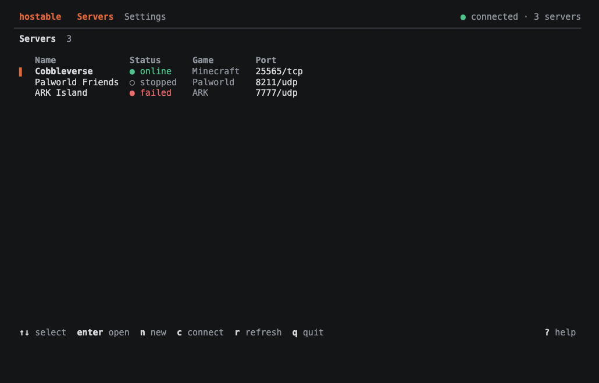
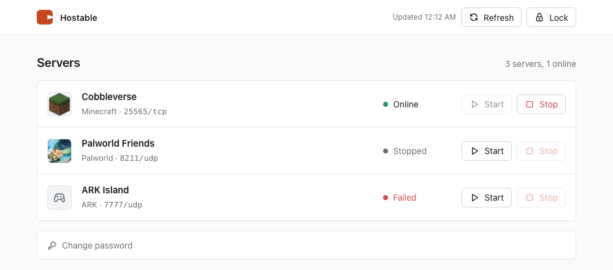

<p align="center">
  
</p>

<h1 align="center">Hostable</h1>

<p align="center">Game servers for you and your friends, in minutes.</p>

<p align="center"><a href="https://hostable.pages.dev">Website</a> · <a href="https://hostable.pages.dev/introduction">Docs</a></p>

`hostable` sets up and runs Minecraft, Palworld and ARK servers on your own VPS. You pay only for the VPS, there are no platform fees, and there is no Docker. It opens the firewall port, writes the systemd service, keeps backups and gives you a terminal UI, a CLI and an optional web page to manage it all.

<p align="center">
  
</p>

## Install

SSH into a fresh Debian or Ubuntu VPS (x86_64 or arm64) and run the install command:

```sh
curl -fsSL https://raw.githubusercontent.com/blankeos/hostable/main/install.sh | sh
```

Then run Hostable:

```sh
sudo hostable
```

The installer adds a `hostabled` daemon (a systemd service running as root; it only answers requests from the machine itself until you turn on the web admin) and the `hostable` command.

## Use

```sh
sudo hostable                       # interactive TUI
sudo hostable list                  # servers and their status
sudo hostable create                # new server (or use the TUI wizard)
sudo hostable import /home/me/srv   # adopt an existing server folder
sudo hostable start|stop|restart <name>
sudo hostable backup <name>
sudo hostable update <name>
sudo hostable console <name> "say hi"
sudo hostable logs <name>
sudo hostable doctor <name>         # diagnose a broken server
sudo hostable preflight             # RAM, disk, ports, swap
sudo hostable upgrade               # update Hostable itself
```

`stop`, `restart` and `update` refuse to run while players are online. Pass `--force` to override.

| Game | Support |
| --- | --- |
| Minecraft | Vanilla, Paper, Fabric, Modrinth modpacks, import existing folders |
| Palworld | Dedicated server through SteamCMD, co-op save import |
| ARK: Survival Evolved | Dedicated server through SteamCMD (one instance per host) |

Players can join with a domain: point an `A` record to the VPS IP in your DNS provider. See [Domains](https://hostable.pages.dev/guides/domains).

## Web admin

An optional web page for starting and stopping servers from a phone, with a read-only view of players, version and mods. Mods, the whitelist, the live console and settings stay in the TUI. It is **off by default**. Turn it on from `Settings` in the TUI. It then listens on port 8080, is protected by a password with a login lockout, and Hostable opens or closes the firewall for you.

<p align="center">
  
</p>

## Security

`hostabled` runs as root, so it treats every request as hostile. The operator token is `0600 root`, the API only trusts loopback until you enable the web admin, all input that reaches systemd units or shell scripts is validated, and Hostable never follows symlinks when backing up or importing. See [docs/security.mdx](docs/security.mdx) and [SECURITY.md](SECURITY.md).

## Docs

Built with [gittydocs](https://github.com/Blankeos/gittydocs). To read them locally:

```sh
bunx gittydocs@latest dev ./docs
```

## Develop

```sh
just dev        # run the TUI against a local daemon
just lint       # fmt + clippy
just test       # cargo tests
just web        # build the admin web page
```

MIT licensed.
